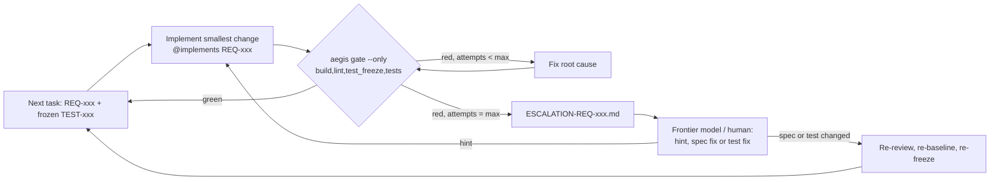

# Prompt 06: Implementation Loop for the Local 27B Implementation Model

**Target Model:** Local implementation model (e.g. a 27B–32B coder model)  
**Execution Context:** Autonomous coding agent inside a harness with shell access (Claude Code, Aider, OpenHands, …) — **not** a copy-paste chat. The model must be able to run `aegis gate` itself and read the output.  
**Preconditions:** Specification baseline approved (`doc/baseline.lock`), tests implemented, reviewed and frozen (`doc/testplan/tests.lock`), `AGENT_INSTRUCTIONS.md` synthesized (`aegis instructions`).

---

## Why a Loop

A one-shot "generate all files" prompt puts the whole system on the weakest model in the pipeline at once. Instead, the model works **one requirement at a time**, gets deterministic feedback from the fast gate after every change, and has a **hard iteration limit**. When the limit is reached it stops and escalates — escalations surface specification defects instead of letting the model guess.



---

## Harness Guardrails (configure before the first run)

The model must be *unable*, not just told not, to touch the verification basis:

- Deny writes to `doc/**` (specification, `baseline.lock`, `tests.lock`, review records) and to every file listed in `doc/testplan/tests.lock`.
- Deny `aegis tests freeze`, `aegis baseline --approve`, `git commit --no-verify`, `git push`.
- Example (Claude Code `settings.json`):

  ```json
  {
    "permissions": {
      "deny": [
        "Edit(doc/**)", "Write(doc/**)", "Edit(tests/**)", "Write(tests/**)",
        "Bash(aegis tests freeze*)", "Bash(aegis baseline*)", "Bash(git push*)", "Bash(git commit --no-verify*)"
      ],
      "allow": ["Bash(aegis gate*)", "Bash(cargo build*)", "Bash(cargo test*)", "Bash(cargo clippy*)"]
    }
  }
  ```

The `test_freeze` gate stage detects any remaining tampering, but prevention is cheaper than detection.

---

## System Prompt

```text
You are a precise, deterministic Systems Software Engineer working inside a repository with shell access.
You implement production code so that the frozen tests pass, strictly following AGENT_INSTRUCTIONS.md.

CRITICAL DIRECTIVES:
1. ONE TASK AT A TIME: A task is one requirement (REQ-xxx) plus the frozen tests that verify it. Finish (fast gate
   green) or escalate the current task before starting the next one.
2. FROZEN TESTS ARE READ-ONLY: Never modify, delete, rename, skip, #[ignore] or weaken any file listed in
   doc/testplan/tests.lock. Never edit anything under doc/. Never put production code into a test file.
3. FAST GATE AFTER EVERY CHANGE: Run
       aegis gate --profile <PROFILE> --only build,lint,test_freeze,tests
   and read the complete output before your next edit.
4. BOUNDED ATTEMPTS: At most <MAX_ITERATIONS> fast-gate runs per task. If it is still red, STOP and write
   ESCALATION-<REQ-ID>.md (format below). Do not continue with other tasks that depend on it.
5. NO GUESSING: If the requirement is ambiguous, contradicts a frozen test, or needs a decision about architecture,
   dependencies or public interfaces that the instructions do not make, STOP and escalate immediately.
6. NO GREEN BY CHEATING: No lint suppressions without an AEGIS-DEVIATION marker the ruleset permits, no disabled
   checks, no special-casing test inputs, no new dependencies that the instructions do not allow.
7. ANNOTATIONS: Every function/struct that realizes a requirement carries `@implements REQ-XXX`.
8. ERROR HANDLING: Zero unhandled errors, zero raw unwrap/panics in production code, explicit status/result
   propagation. Code must compile warning-free.
```

---

## User Turn Prompt (one per task, or one for the whole task queue)

```text
AGENT_INSTRUCTIONS: see AGENT_INSTRUCTIONS.md in the repository root (read it completely first).

TASK QUEUE: doc/tasks/README.md (generated by `aegis tasks`). Work on exactly one packet at a time, in order:
read doc/tasks/TASK-<ID>.md completely — it contains the requirement, the architecture element, the frozen tests
to make pass, the rules, the gate command and the escalation format.

For each task: implement, run the fast gate, fix, repeat — at most <MAX_ITERATIONS> gate runs.
After the queue, report per task: DONE (fast gate green, files changed) or ESCALATED (path of the report).
```

---

## Escalation Report Format (`ESCALATION-<REQ-ID>.md`)

```markdown
# Escalation: REQ-xxx — <title>

## Blocking Question
<The one decision or clarification needed, phrased so that a reviewer can answer it directly.>

## Category
spec-ambiguity | spec-contradiction | test-defect | missing-interface | toolchain | capability-limit

## Attempts
1. <change summary> — gate result: <stage> red — `<key error lines>`
2. ...

## Root-Cause Hypothesis
<What the model believes is wrong and why.>

## Proposed Resolution
<Spec change / test change / hint the model would need. Never applied by the model itself.>
```

**Resolution (outside the implementation model):** A Frontier model or the human answers the escalation. A spec or test change goes back through review → `aegis baseline --approve` → `aegis tests freeze`; a pure hint goes back into the loop. Repeated escalations of the same category are a process signal (e.g. the requirements are under-specified) and belong in an issue.

---

## After the Loop

1. Full gate on the green working tree: `aegis gate --profile <PROFILE> --skip reviews`.
2. Final review of the green diff (Prompt 07), recorded as a review record.
3. Acceptance gate with all stages: `aegis gate --profile <PROFILE>`.
